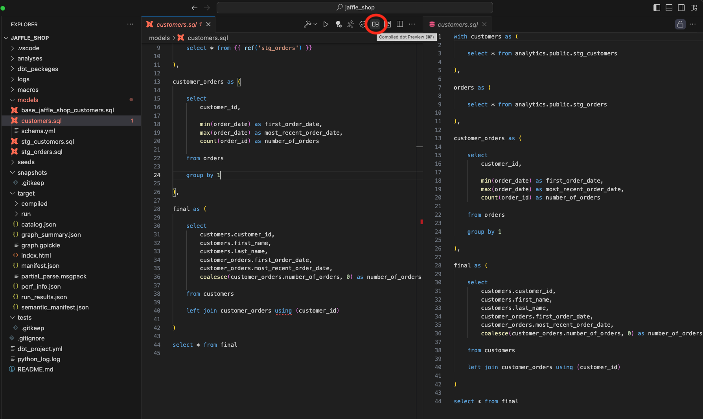

## Preview compiled code (SQL)

The toolbar action to preview compiled code is present on the top right corner of the VSCode as shown in the image below:

## Watch the Video

<figure class="video-clip">

<iframe src="https://www.youtube.com/embed/1yWejM5YW1o?rel=0&amp;start=689" title="Power User multiple features demo" loading="lazy" allow="accelerometer; clipboard-write; encrypted-media; gyroscope; picture-in-picture; web-share" referrerpolicy="strict-origin-when-cross-origin" allowfullscreen></iframe>

<figcaption>Video (44:55): Power User multiple features demo. It starts at 11:29, where this page's feature begins. <a href="https://www.youtube.com/watch?v=1yWejM5YW1o&amp;t=689s" target="_blank" rel="noopener">Watch on YouTube</a>.</figcaption>
</figure>
