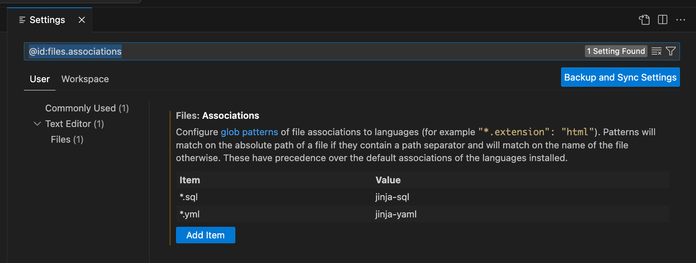

/// admonition | Only use the following steps for "dbt Fusion" environments. If you have a dbt Core environment, use the [required config instructions for "dbt Core" environments](./reqdConfig.md). If you have a dbt Cloud environment, use the [required config instructions for "dbt Cloud" environments](./reqdConfigCloud.md).
    type: warning
///

/// admonition | dbt Fusion integration provides enhanced performance and features
    type: tip
///

## What is dbt Fusion?

dbt Fusion is a command-line interface that provides enhanced dbt functionality with improved performance and additional features. Unlike standard dbt Core, dbt Fusion is a standalone executable that doesn't require a Python environment, making it easier to install and manage.

### Key Benefits of dbt Fusion Integration:
- **Standalone Installation**: No Python environment required
- **Enhanced Performance**: Optimized execution compared to standard dbt
- **Cross-Platform Support**: Available for macOS, Linux, and Windows
- **Simple Setup**: Single executable installation
- **Full VSCode Integration**: Complete feature support in the extension

## No Python or Python extension needed

Power User for dbt runs dbt Fusion without Python and without the Python extension (`ms-python.python`). In dbt Fusion mode it opens, parses and runs your project without asking for a Python interpreter, and the Get Started panel skips its Python interpreter check. Features that run Python code themselves still need an interpreter: Altimate notebooks, the project healthcheck and installing sqlfmt.

Power User looks for dbt Fusion next to the selected Python interpreter (if there is one), in `~/.local/bin` and on your `PATH`. If none of them has a `dbt` that reports version 2.x, it shows:

> dbt Fusion was not found: no dbt that reports version 2.x next to the Python interpreter, in ~/.local/bin, or on PATH.

**Install dbt Fusion** installs it, and **Troubleshoot** opens the Get Started panel.

## Automatic dbt Fusion mode for dbt 2.x projects

If you haven't set `dbt.dbtIntegration` yourself, Power User for dbt chooses the mode when the window opens. It switches the window to dbt Fusion mode only when all of these are true:

- the `dbt` it finds for your project is dbt Fusion (version 2.x);
- the selected Python interpreter, if there is one, can't import dbt-core;
- dbt Core hasn't worked on this machine in the last 7 days (see [When dbt Core worked recently](#when-dbt-core-worked-recently));
- dbt Fusion supports the adapter in your dbt profile, or runs it as an experimental adapter and `DBT_ALLOW_EXPERIMENTAL_ADAPTERS=true` is set (in `terminal.integrated.env.<os>`, or in the environment VS Code starts with); and the profile is found;
- there is no dbt-loom config: no `dbt_loom.config.yml` at a workspace folder root or next to a `dbt_project.yml`, and no `DBT_LOOM_CONFIG_PATH` environment variable;
- this dbt Fusion has parsed every project in the workspace in a trial run.

### The trial parse

The first window that could switch keeps dbt Core mode and runs dbt Fusion's `parse` on each project in the background. The trial writes nothing into your project: its target, logs and packages go to a folder in the system temp directory, which is removed afterwards. A project that declares packages gets them installed into that folder from a copy of its package files, so the trial needs access to the dbt package hub. A project with a `local:` package can't be tried this way, so it doesn't pass. Each project gets up to 3 minutes, and the whole trial up to 5 minutes.

Power User remembers the result for the workspace and that dbt Fusion binary (its path and version):

- **It parsed:** the next window opens in dbt Fusion mode.
- **It didn't:** windows keep dbt Core mode for 24 hours, then run the trial again.
- A new dbt Fusion version, or a binary at another path, gets a trial of its own.
- If a switched window's first parse has errors, Power User offers once to switch back to dbt Core, and forgets the pass, so the next window runs the trial again.

When the window switches, Power User tells you once per project, for example:

> Power User for dbt is using dbt Fusion for jaffle_shop: the dbt on your path is dbt 2.0.9, which needs dbt Fusion mode. Set dbt.dbtIntegration to choose a mode yourself.

**Open setting** opens the `dbt.dbtIntegration` setting.

### When dbt Core worked recently

A window keeps dbt Core mode when dbt Core worked on this machine in the last 7 days, that is when either:

- a dbt Core mode window read a dbt 1.x project on this machine. Power User records this for the machine (one VS Code profile), not for the workspace: dbt Core used in one repository keeps every other workspace in dbt Core mode for 7 days, including one that only uses dbt Fusion;
- dbt Core's `partial_parse.msgpack` in one of the workspace's projects changed in that time. Power User looks in `DBT_TARGET_PATH`, else the project's `target-path`, else `target`. dbt Fusion doesn't write this file. A `partial_parse.msgpack` committed to the repository counts from its file time.

To use dbt Fusion in such a workspace sooner, set `dbt.dbtIntegration` to `fusion`, or choose **Use dbt Fusion** where Power User offers it.

### When the window keeps dbt Core mode

Where dbt Core mode works, Power User tells you once per workspace why it didn't switch, for example:

> Power User didn't switch this window to dbt Fusion 2.0.9 (/home/you/.local/bin/dbt): the selected interpreter has dbt-core, so the window keeps dbt Core mode.

The reason can also be an adapter dbt Fusion doesn't support or runs only as experimental, a dbt profile that isn't found, a dbt-loom config, or a dbt-core check that couldn't tell. **Use dbt Fusion** sets `dbt.dbtIntegration` to `fusion` in the workspace settings, and the window reloads in dbt Fusion mode. **Dismiss** keeps dbt Core mode. A window waiting for its trial, held after a failed trial, or held because dbt Core worked recently shows nothing while dbt Core mode works.

Where dbt Core mode can't start (the interpreter has no dbt-core), the same reason replaces the "dbt is not installed" error, and most reasons also offer **Install dbt Core**. A profile that isn't found offers to open `profiles.yml` or `dbt_project.yml` instead. After a trial, that message gives its result. Where the trial parsed:

> dbt Fusion 2.0.9 (/home/you/.local/bin/dbt) parsed jaffle_shop. dbt Core mode needs dbt-core, which the selected Python interpreter does not have. Reload the window to use dbt Fusion.

**Reload with dbt Fusion** reloads the window, which then opens in dbt Fusion mode. Where it didn't pass, the error says why, such as dbt Fusion's first error or a package it couldn't install, and offers Install dbt Core and Use dbt Fusion.

Without a usable Python (no Python extension, no interpreter, or one that no longer exists), Power User shows its Python error with its own fix, and adds one of two things:

- where dbt Fusion can run (its trial is still running or has parsed, or the dbt-core check couldn't tell): "…, or use dbt Fusion 2.0.9 (/home/you/.local/bin/dbt), which is on your path and runs without Python." and **Use dbt Fusion**;
- otherwise, the reason the window kept dbt Core mode, such as the unsupported adapter or the trial's first error.

A `dbt.dbtIntegration` value you set, in user, workspace or folder settings, is always used as is. Choosing an integration type in the Get Started panel also sets it, so after that the mode no longer changes by itself. The mode applies to the whole window: in a multi-root workspace, every project uses it.

## Use the setup wizard for configuration (recommended)

/// admonition | Need to setup environment variables? Refer to this [section](/setup/optConfig/#environment-variables-setup)
    type: warning
///

This method will save a bunch of time for you, and you can also validate your configuration. The setup wizard will help you in associating SQL files with jinja-sql, installing dbt Fusion if needed, and validating your project configuration.

You can start the setup wizard by clicking on the dbt status icon in the bottom status bar, and perform the following necessary steps:

<div style="position: relative; box-sizing: content-box; max-height: 80vh; max-height: 80svh; width: 100%; aspect-ratio: 1.50; padding: 40px 0 40px 0;">
  <iframe src="https://app.supademo.com/embed/cmnt1t4jz4hj3cr4j3knosm74?embed_v=2&utm_source=embed" loading="lazy" title="Power User for dbt Setup guide-Fusion" allow="clipboard-write" frameborder="0" webkitallowfullscreen="true" mozallowfullscreen="true" allowfullscreen style="position: absolute; top: 0; left: 0; width: 100%; height: 100%;"></iframe></div>

**Here are the steps covered in the setup wizard**

**Select dbt Integration Type**

In the setup wizard, choose "dbt Fusion" as your integration type. This will configure the extension to use the dbt Fusion CLI for all dbt operations.

**Install dbt Fusion**

If dbt Fusion is not installed in your system (the dbt status icon on the bottom status bar will show it), click on "Install dbt Fusion" button. The setup wizard will automatically install the latest version of dbt Fusion using the appropriate method for your operating system:

- **macOS/Linux**: Uses curl to download and install from dbt Labs CDN
- **Windows**: Uses PowerShell to download and install from dbt Labs CDN

**Associate SQL Files**

The wizard will help you associate `*.sql` files with `jinja-sql` language mode for proper syntax highlighting and IntelliSense support.

**Validate Project**

The last step is clicking the "Validate Project" button. It will run a bunch of checks to make sure your dbt Fusion environment and project are set up correctly. If there are issues, it will tell you exactly what's wrong.

/// admonition | If you still can't get the extension setup correctly, please contact us via slack or chat through [support page](https://www.altimate.ai/support?utm_source=help-docs&utm_medium=referral&utm_campaign=docs-inline-link)
    type: tip
///

## Manual method of configuration

/// admonition | Please follow the manual method only if you couldn't use the setup wizard above.
    type: info
///

### Step 1: Install dbt Fusion

#### Automatic Installation via Extension

1. Open the Command Palette (`Ctrl+Shift+P` / `Cmd+Shift+P`)
2. Type "Power User for dbt: Install dbt"
3. Select the command and choose "dbt Fusion" when prompted
4. The extension will automatically download and install dbt Fusion for your platform

#### Manual Installation

**macOS and Linux:**
```bash
curl -fsSL https://public.cdn.getdbt.com/fs/install/install.sh | sh -s -- --update
```

**Windows (PowerShell):**
```powershell
irm https://public.cdn.getdbt.com/fs/install/install.ps1 | iex
```

#### Verify Installation

After installation, verify that dbt Fusion is properly installed by running:
```bash
dbt --version
```

You should see output that includes "dbt-fusion" in the version information.

### Step 2: Configure dbt Integration Type

Set the integration type to fusion in your VSCode settings:

/// admonition | For a dbt 2.x project you may not need this step: with `dbt.dbtIntegration` unset, Power User for dbt can choose dbt Fusion mode by itself. See [Automatic dbt Fusion mode](#automatic-dbt-fusion-mode-for-dbt-2x-projects). Set it to `fusion` to choose the mode yourself.
    type: info
///

#### Method 1: Via VSCode Settings UI
1. Open VSCode Settings (`Ctrl+,` / `Cmd+,`)
2. Search for "dbt integration"
3. Set "Dbt: Dbt Integration" to "fusion"

#### Method 2: Via settings.json
Add the following to your VSCode settings.json:
```json
{
    "dbt.dbtIntegration": "fusion"
}
```

### Step 3: Associate *.sql files with jinja-sql

#### Method 1: Configure in Preferences > Settings


#### Method 2: Update settings.json directly
```json
{
    "files.associations": {
        "*.sql": "jinja-sql",
        "*.yml": "jinja-yaml"
    }
}
```

### Step 4: Verify Configuration

After configuration, check that:
1. The bottom status bar shows "dbt fusion" with a checkmark
2. You can execute dbt commands through the extension
3. IntelliSense and syntax highlighting work in your dbt files

## Enable SaaS features by adding API key

There are multiple features in the extension, including [generate dbt documentation](../document/generatedoc.md), [column lineage](../test/lineage.md), [query explanation](../develop/explanation.md), [generate dbt model from SQL](../develop/genmodelSQL.md) that require an API key.

/// details | You can get an API key for free by signing up at [www.altimate.ai](https://www.altimate.ai?utm_source=help-docs&utm_medium=referral&utm_campaign=docs-inline-link)

<interactive demo to get an API key>

<div style="position: relative; padding-bottom: calc(51.70312500000001% + 44px); height: 0;"><iframe src=https://app.supademo.com/embed/yanO4l-w5hH0xzXf93w-d frameborder="0" webkitallowfullscreen="true" mozallowfullscreen="true" allowfullscreen style="position: absolute; top: 0; left: 0; width: 100%; height: 100%;"></iframe></div>

///

You need to add the API key from "Settings->API key" in your Altimate instance to the VSCode extension settings. You also need to add "Instance name" in the extension settings. Please get your instance name from your Altimate AI URL. If your URL for Altimate instance is - "companyx.app.myaltimate.com", then instance name is "companyx".

Go to VSCode extension settings, and add API key and instance name there.

/// details | Here's demo of how to add instance name and API Key to the extension settings

<Interactive demo to add API key in the extension>

<div style="position: relative; padding-bottom: calc(57.25% + 44px); height: 0;"><iframe src=https://app.supademo.com/embed/clnjpwl3u07x4pedv9ifjfuf9 frameborder="0" webkitallowfullscreen="true" mozallowfullscreen="true" allowfullscreen style="position: absolute; top: 0; left: 0; width: 100%; height: 100%;"></iframe></div>
///

## Feature Support

dbt Fusion integration supports most extension features with some exceptions:

### ✅ Supported Features
- **Query Execution**: Execute models and preview results
- **SQL Compilation**: View compiled SQL code
- **Auto-completion**: IntelliSense for models, macros, and sources
- **Column Lineage**: Trace data lineage between models
- **SQL Validation**: Validate SQL without execution
- **Defer to Production**: Run models without rebuilding dependencies, using a production manifest in a local path. With the manifest stored in the Altimate SaaS instance (SaaS mode), Power User logs a warning once per project in the `Log - dbt` output and runs without deferral.
- **Test Generation**: AI-powered test generation
- **Query Explanation**: AI-powered SQL explanation
- **dbt Docs Generation**: The **Run Dbt Docs Generate** command and docs sharing work on dbt Fusion 2.0.9 or newer

### ❌ Limited Features
- **dbt Docs Generation before dbt Fusion 2.0.9**: Power User shows "Could not generate docs: dbt fusion does not support docs generation. To generate docs, update dbt Fusion to 2.0.9 or newer, or set dbt.dbtIntegration to core or cloud."
- **Some Advanced Features**: May have limitations compared to dbt Core integration

## Questions and Answers

#### What is dbt Fusion and how is it different from dbt Core?

dbt Fusion is an enhanced command-line interface for dbt that provides improved performance and additional features. Unlike dbt Core, which requires a Python environment, dbt Fusion is a standalone executable that can be installed independently.

#### Is dbt Fusion integration free?

Yes, dbt Fusion integration is free and treated the same as integration with dbt Core. It will not count towards the usage quota for AI features.

#### Do I need Python installed to use dbt Fusion?

No, dbt Fusion is a standalone executable that doesn't require a Python environment. This makes it easier to install and manage compared to dbt Core. In dbt Fusion mode, Power User for dbt doesn't need Python or the Python extension either.

#### Can I switch between dbt Core and dbt Fusion integrations?

Yes, you can switch between integration types by changing the `dbt.dbtIntegration` setting in VSCode. The window reloads in the new mode, and the extension will automatically detect and use the appropriate dbt executable. If you leave the setting unset, a dbt 2.x project can open in dbt Fusion mode by itself; see [Automatic dbt Fusion mode](#automatic-dbt-fusion-mode-for-dbt-2x-projects).

#### What if dbt Fusion is not available for my platform?

dbt Fusion supports macOS, Linux, and Windows. If you encounter installation issues, you can fall back to using dbt Core or dbt Cloud integrations instead.

#### Why do I need to add the Altimate API key?

The API key is necessary for advanced AI-powered features like query explanation, test generation, and column lineage. Basic dbt operations (execution, compilation) work without an API key.